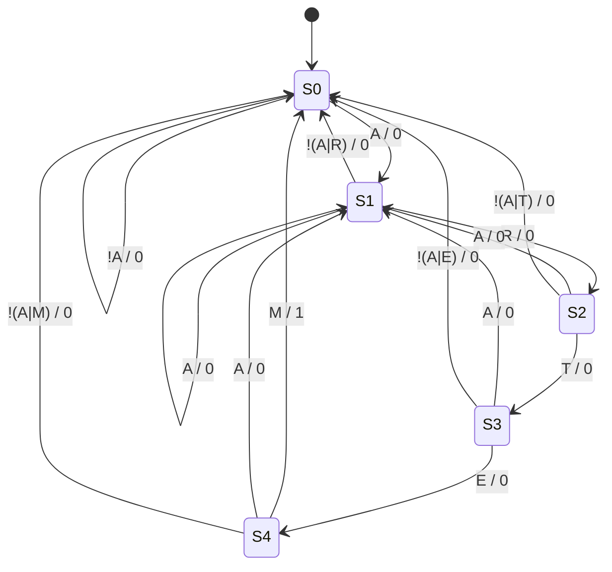

# Лабораторная работа №2

**Задание**:
1) Определить свой порядковый номер в группе (считать с 1).
2) Если номер делится на 2 без остатка, то придумать автомат Мура, в противном случае - автомат Мили.
3) Нарисуйте его диаграмму.
4) Условия модуля:
    - разрядность входа автомата равна 8 битам, а разрядность выхода - 1 биту.
    - выход должен принять значение 1, когда на вход поступило Ваше имя (латинскими буквами в кодировке ASCII).
5) Описать конечный автомат на SystemVerilog.
6) Написать для него тестбенч, выполняющий обход графа переходов, т.е. все имеющиеся переходы из одного состояния в другое. Проверка правильности работы должна выполняться автоматически (assert).
7) Запустить симуляцию и визуально убедиться по временной диаграмме (вейвформе, waveform), что конечный автомат реализован правильно.
> Подсказка: можно увидеть подаваемые буквы, нажав ПКМ на название сигнала на временной диаграмме и выбрав Data Format -> ASCII.

8) Создать проект в Gowin EDA, добавить в него файл с описанием конечного автомата.
9) Выполнить синтез, изучить схематику, посмотреть затраченные ресурсы (Resource Usage Summary) типов Register и LUT.

**Вариант**:
> Номер `5` — автомат Мили. Имя: `ARTEM`.

## Буквы

| Буква | ASCII, hex (биты) |
| --- | --- |
| A | 41 (01000001) |
| R | 52 (01010010) |
| T | 54 (01010100) |
| E | 45 (01000101) |
| M | 4D (01001101) |

## Диаграмма автомата

Подпись перехода: вход / выход. При `rst = 1` на переднем фронте `clk` состояние становится S0.



## Состояния

| Состояние | Код | Распознанный префикс |
| --- | --- | --- |
| S0 | 0 (000) | — |
| S1 | 1 (001) | A |
| S2 | 2 (010) | AR |
| S3 | 3 (011) | ART |
| S4 | 4 (100) | ARTE |

## Переходы

| Состояние | Вход data | Следующее состояние | Выход y |
| --- | --- | --- | --- |
| S0 | A | S1 | 0 |
| S0 | Любой, кроме A | S0 | 0 |
| S1 | R | S2 | 0 |
| S1 | A | S1 | 0 |
| S1 | Любой, кроме A, R | S0 | 0 |
| S2 | T | S3 | 0 |
| S2 | A | S1 | 0 |
| S2 | Любой, кроме A, T | S0 | 0 |
| S3 | E | S4 | 0 |
| S3 | A | S1 | 0 |
| S3 | Любой, кроме A, E | S0 | 0 |
| S4 | M | S0 | 1 |
| S4 | A | S1 | 0 |
| S4 | Любой, кроме A, M | S0 | 0 |

`y = 1` при `state = S4` и текущей букве `M`, до обновления состояния на переднем фронте. Для имени не требуется дополнительное состояние.

## Тестовые последовательности

| Вход | Что проверяется |
| --- | --- |
| X | Посторонний символ в S0 |
| AAX | Повтор A, затем ошибка в S1 |
| ARAX | Новая A после AR |
| ARX | Ошибка в S2 |
| ARTAX | Новая A после ART |
| ARTX | Ошибка в S3 |
| ARTEAX | Новая A после ARTE |
| ARTEX | Ошибка в S4 |
| ARTEMARTEM | Два имени подряд |
| AARTEM | Имя после повторной A |
| artem | Строчные буквы |
| 00 (00000000), FF (11111111) | Байты вне имени |
| ARTEAM | Неполное повторное начало имени |

В `sim/sequence.tv` записаны 60 векторов: 8 бит входа, 3 бита ожидаемого состояния после фронта и 1 бит ожидаемого выхода до фронта.

Формат тест-вектора: `XXXXXXXX_SSS_Y`.

`assert` проверяет выход и переход в состояние. Сигналы подаются по заднему фронту. На переднем фронте проверяется выход до обновления состояния, а на следующем заднем фронте — новое состояние.

## Makefile

```sh
# Из корня репозитория:
make -C lab_2/sim        # Компиляция и симуляция
make -C lab_2/sim synth  # Только компиляция
make -C lab_2/sim sim    # Компиляция и симуляция
make -C lab_2/sim wave   # Симуляция и просмотр вейвформ
make -C lab_2/sim clean  # Удаление сгенерированных файлов
```

## Gowin EDA

1) Запустить Gowin: `LD_LIBRARY_PATH=<...>/gowin/IDE/lib/ gw_ide`.
2) Создать проект, нажав на “New Project...”.
3) Выбрать FPGA Design Project, нажать OK.
4) Ввести название проекта и путь, в котором будет создана папка с проектом (рекомендую создать папку build в директории, в которой находятся sim и rtl, и нужно убедиться, что в пути только английские символы), нажать `Next >`.
5) Выбрать семейство ПЛИС (Series) GW2A, выделить из списка нажатием модель ПЛИС, нажать `Next >`.
6) Нажать Finish.
7) В поле слева (где написано GW2A-LW...) нажать ПКМ -> Add Files... Выбрать реализацию модуля (из папки rtl).
8) Во всплывшем окне Add files, предлагающем скопировать исходник модуля из папки rtl в папку проекта, нажать No. В результате файл добавлен в проект.
9) Сверху выбрать Project -> Configuration. Во вкладке Synthesize поменять значение Verilog Language на “System Verilog 2017”, нажать OK.
10) Слева внизу выбрать вкладку Process, сделать двойной клик по Synthesize. Выполнится синтез модуля.
11) Нажав двойным кликом на Synthesis Report можно посмотреть отчет о синтезе. В разделе Resource находится информация о количестве используемых аппаратных ресурсов.
12) Выбрав сверху Tools -> Schematic Viewer -> RTL Design Viewer, можно открыть графическое изображение цифровой схемы, которая была описана на HDL.
